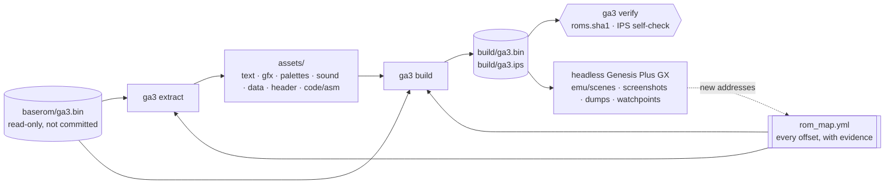

<div align="center">


**English** · [Русский](README.ru.md)


[](LICENSE)
[](#legal)
[](https://github.com/eugenez36/golden-axe3-game-rus/actions/workflows/ci.yml)

</div>

---

A ROM-hacking toolkit for **Golden Axe III** (Sega Mega Drive, 1993) built around
the **NEWGAME 2003 Russian translation**. The cartridge image is taken apart into
an editable tree of assets — text, font, Nemesis graphics, tile sheets, palettes,
samples, data tables, code listings — and rebuilt **byte for byte** from it.
Every change is proved inside the real game with a **headless Genesis Plus GX**:
no window, just scripts, screenshots and memory dumps.

Nothing here is guessed. Every offset lives in one file, `rom_map.yml`, with the
evidence that put it there.

```text
baserom/ga3.bin ──ga3 extract──▶ assets/ ──ga3 build──▶ build/ga3.bin + build/ga3.ips
   (yours, never                 (committed,              (verified against
    committed)                    the ROM taken apart)     roms.sha1)
```

## Highlights

- **Reproducible build.** `make` rebuilds the image from `assets/`; `make verify`
  checks it against `roms.sha1`. Freshly extracted assets give back the base
  ROM to the byte; the committed ones give the build recorded in `roms.sha1`.
- **The ROM, taken apart.** Header and vectors as YAML, 227 strings in nine text
  files, the font as text art, 14 Nemesis blocks, 22 indexed-PNG sheets of tile
  art, the PCM region, the HP table, six captured palettes and Capstone listings
  of every code segment. What is still unidentified is measured, not hidden:
  `ga3 map` prints the coverage.
- **Nemesis codec, both ways.** Decoder lifted from the game's disassembly and
  verified against a VRAM dump (3072/3072 bytes). The encoder beats SEGA's on
  all 14 blocks (13 780 vs 14 045 bytes); its output differs from SEGA's, so for
  byte identity the build reuses the original blocks verbatim until you edit
  them.
- **Font editing in plain text.** Glyphs as `#`/`.` art. **Ё**, **ё**, **Ъ**,
  Latin **V** and the parentheses were added to a translation that never had
  them; the build refuses a font that would not fit its 840-byte slot.
- **Gameplay by name.** `ga3 balance set-hp 60 60 60 60` edits a YAML table;
  the address is the map's business.
- **New code in 68000 assembly.** Patches live in `assets/patches/*.s`, are
  assembled by the built-in `ga3.m68k` (every instruction form checked with
  Capstone) and hook the game only where the base ROM holds the expected
  bytes. The first one shows each player's kills next to their HUD
  ([docs/patches.md](docs/patches.md)).
- **Emulator as a measuring instrument.** Scripted input, screenshots, VDP and
  RAM dumps, watchpoints, breakpoints and a `dma_hook` added to the core so DMA
  sources can be traced. A cheat-engine-style RAM correlator finds values from
  screenshots (player HP: r = 1.0000).

## Quick start

> The ROM is not part of this repository. Put your own dump at `baserom/ga3.bin`
> (1 MiB, SHA-1 `e9538c05…`, see [baserom/README.md](baserom/README.md)).
> Full setup: [INSTALL.md](INSTALL.md).

```bash
git clone --recurse-submodules https://github.com/eugenez36/golden-axe3-game-rus.git
cd golden-axe3-game-rus
make venv && source .venv/bin/activate

make            # build/ga3.bin + build/ga3.ips from assets/
make verify     # sha1sum -c roms.sha1
make test       # pytest (ROM-gated tests skip without the ROM)

# edit something
$EDITOR assets/text/dialogue.txt          # a string; may not grow
$EDITOR assets/gfx/font/font.txt          # a glyph
ga3 balance set-hp 60 60 60 60            # the HP table
make && ga3 verify --update               # rebuild, record the new hash

# see it in the actual game
make emu && make regress                  # screenshots land in build/shots/
ga3 emu emu/scenes/dialogue_pages.txt

# look around
ga3 map                                   # coverage: what is still unknown
ga3 map --check                           # the map against the base ROM
ga3 extract --png                         # Nemesis previews in build/preview/
ga3 disasm E482 -n 12                     # the HP table's reader
```

## How it fits together



## Repository layout

```text
rom_map.yml       the single home of every ROM offset (splat-style segments)
roms.sha1         sha1 of the base ROM and of the build; `make verify`
Makefile          venv · build · extract · verify · test · lint · assets · asm · emu · regress · clean · distclean · help
pyproject.toml    the ga3 package and its `ga3` command
baserom/          put your ROM here (ignored)
assets/           the ROM taken apart — see STYLE.md for what is committed
  header/         vectors.yml, header.yml
  text/           menu · stages · ending · dialogue · misc · menu_items · code_main_{b,d,e} .txt, encoding.tbl
  gfx/            font/font.txt, nemesis/*.nem, tiles/art_*.png (indexed)
  palettes/       *.pal captured from the emulator (no ROM source known yet)
  sound/pcm/      samples.pcm
  data/           hp_table.yml
  code/asm/       Capstone listings (generated)
build/            everything derived (ignored): ROM, IPS, emulator, shots, dumps, previews
src/ga3/          the toolkit: rom · nemesis · table · text · font · tiles · palette · rom_map · assets/ · pipeline · patches · m68k · balance · disasm · ramsearch · lag · cli
tests/            pytest; ROM-free fixtures plus ROM-gated tests
emu/              gpgx (submodule) · patches/ · headless/ · scenes/ · explore/
docs/             README (index) · build · text_format · nemesis · font · emulator · patches · rom_map (generated) · evidence/ · images/ · branding/ · ru/journal.md · ru/proofreading.md
```

## ROM map

Generated from `rom_map.yml`: [docs/rom_map.md](docs/rom_map.md). The short version:

| Range                            | Contents                                                                                                                                                                                      |
|----------------------------------|-----------------------------------------------------------------------------------------------------------------------------------------------------------------------------------------------|
| `000000–000200`                  | vectors and header (entry point moved by the translators to `0FFA20`)                                                                                                                         |
| `000200–01B780`                  | 68000 code, with the HP table at `00E492`, a Nemesis block at `013E76`, the menu / stage / ending text, the menu-version routine, the main-menu items and the kill counter at `0116B6–011800` |
| `01B780–01E3DC`                  | 12 Nemesis blocks nearly back to back (a 6-byte data stub after the font, 43 unknown bytes at `01E26F`), the font at `01D85E` (840 B)                                                         |
| `0295EE–029F08`                  | one more Nemesis block (208 tiles)                                                                                                                                                            |
| `05AEAA–05AFC6`, `05B30A–05B41A` | the kill counter's display code and digit glyphs, in two former holes                                                                                                                         |
| `080000–0D8000`                  | 11 264 uncompressed 4bpp tiles                                                                                                                                                                |
| `0E9B00–0EC300`                  | dialogue, credits, ending text                                                                                                                                                                |
| `0FC000–0FFA20`                  | PCM samples                                                                                                                                                                                   |
| `0FFA20–100000`                  | the relocated entry stub                                                                                                                                                                      |

Free space: **28 bytes** left of the 914 in three verified holes; the patches
(menu version, menu items, kill counter) hold the rest. About half of the image is
still `unknown`; `ga3 map` prints the exact figure and the ranges.

## Roadmap

- [x] **v0.1 — Text & Font** · byte-exact round-trip, glyph editor, Ё / Ъ / ( ), translator credit
- [x] **v0.2 — Nemesis packer parity** · smaller than the original on all 14 blocks, self-verifying
- [x] **v0.3 — Headless emulator** · scenes, screenshots, dumps, watchpoints, `dma_hook`
- [x] **v0.35 — Reproducible build** · `rom_map.yml`, `assets/`, `build/`, `roms.sha1`, tests, CI
- [ ] **v0.4 — Gameplay tables** · lives, magic, timers (method ready in `ga3 ramsearch`); kill counter done
- [ ] **v0.5 — Palettes and tilemaps in ROM** · turn the grey tile sheets into real colours
- [ ] **v1.0 — Release IPS** · verified patch with RU + EN docs

Progress is tracked in [milestones](https://github.com/eugenez36/golden-axe3-game-rus/milestones).

## Playing

Apply `build/ga3.ips` to your own dump, or run `build/ga3.bin`, in any Mega
Drive emulator. In Genesis Plus GX (RetroArch), *System Overclock* 150–200%
shortens the pauses while magic loads and *Remove Per-Line Sprite Limit*
removes flicker; numbers in [docs/emulator.md](docs/emulator.md#lag-and-overclock).
The small blue box right of each HUD counts the enemies that player has killed
(up to 99); it starts from zero when a game mode is chosen in the main menu
and is not shown in a duel.

## Documents

[INSTALL.md](INSTALL.md) · [STYLE.md](STYLE.md) · [CONTRIBUTING.md](CONTRIBUTING.md) ·
[docs/build.md](docs/build.md) · [docs/text_format.md](docs/text_format.md) ·
[docs/nemesis.md](docs/nemesis.md) · [docs/font.md](docs/font.md) ·
[docs/emulator.md](docs/emulator.md) · [docs/patches.md](docs/patches.md) ·
[docs/evidence](docs/evidence/README.md) ·
**[engineering journal (Russian)](docs/ru/journal.md)** — how each address was found, dead ends included.

## Legal

- **No ROM is distributed here**, and none ever will be. Golden Axe III is © SEGA.
  "SEGA", "Mega Drive", "Genesis" and "Golden Axe" are trademarks of SEGA Corporation.
- `assets/` contains data extracted from the game in editable form so that
  changes can be reviewed as diffs. Together with a base ROM it reproduces the
  image; the repository alone does not — code and unidentified regions are
  deliberately not committed (see [STYLE.md](STYLE.md)).
- The Russian translation this toolkit targets is the work of **NEWGAME (2003)**.
- The toolkit is [MIT](LICENSE). Genesis Plus GX is by Charles MacDonald and
  Eke-Eke under its own **non-commercial** license; see
  [THIRD_PARTY_NOTICES.md](THIRD_PARTY_NOTICES.md).

<div align="center">
<sub>Built with a hex editor, a disassembler, and far too many screenshots of an orc.</sub>
</div>
