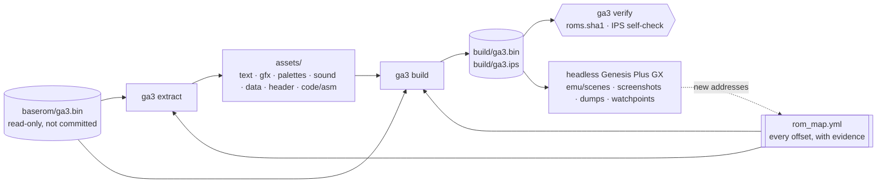

<div align="center">


**English** · [Русский](README.ru.md)


[](LICENSE)
[](#legal)
[](https://github.com/eugenez36/golden-axe3-game-rus/actions/workflows/ci.yml)

</div>

---

A ROM-hacking toolkit for **Golden Axe III** (Sega Mega Drive, 1993) built around
the **NEWGAME 2003 Russian translation**. The cartridge image is taken apart into
an editable tree of assets — text, font, Nemesis graphics, tile sheets, palettes,
samples, data tables, code listings — and rebuilt **byte for byte** from it.
Every change is proved inside the real game with a **headless Genesis Plus GX**:
no window, just scripts, screenshots and memory dumps.

Nothing here is guessed. Every offset lives in one file, `rom_map.yml`, with the
evidence that put it there.

```text
baserom/ga3.bin ──ga3 extract──▶ assets/ ──ga3 build──▶ build/ga3.bin + build/ga3.ips
   (yours, never                 (committed,              (verified against
    committed)                    the ROM taken apart)     roms.sha1)
```

## Highlights

- **Reproducible build.** `make` rebuilds the image from `assets/`; `make verify`
  checks it against `roms.sha1`. Freshly extracted assets give back the base
  ROM to the byte; the committed ones give the build recorded in `roms.sha1`.
- **The ROM, taken apart.** Header and vectors as YAML, 229 strings in twelve text
  files, the font as text art, 14 Nemesis blocks, 22 indexed-PNG sheets of tile
  art, the PCM region, the HP table and gameplay constants, the hero panel's
  data, six captured palettes and Capstone listings
  of every code segment. What is still unidentified is measured, not hidden:
  `ga3 map` prints the coverage.
- **Nemesis codec, both ways.** Decoder lifted from the game's disassembly and
  verified against a VRAM dump (3072/3072 bytes). The encoder beats SEGA's on
  all 14 blocks (13 780 vs 14 045 bytes); its output differs from SEGA's, so for
  byte identity the build reuses the original blocks verbatim until you edit
  them.
- **Font editing in plain text.** Glyphs as `#`/`.` art. **Ё**, **ё**, **Ъ**,
  Latin **V**, the parentheses and **/** were added to a translation that never
  had them; the build refuses a font that would not fit its 840-byte slot (837
  used).
- **Gameplay by name.** `ga3 balance show` lists every table and constant;
  `ga3 balance set-hp 60 60 60 60` edits the HP table, `set lives 5` /
  `set credits 9` / `set potions 3` the spare lives, the continues and the
  default of OPTIONS → БАНКИ МАГИИ (starting magic potions, 0–6), `set
  kain_super 20` / `set magic_l2 40` a hero's hit and launch powers and the
  spells' damage, `set walk_speed.kain_x 0x200` / `set move_speed.jump_sarah
  0x700` the walking, dash and jump speeds of every class. The hero panel on
  the character select reads the same files, so it never disagrees with the
  game. These are numbers inside the code and its tables, each checked against
  the base ROM; the addresses are the map's business.
- **New code in 68000 assembly.** Patches live in `assets/patches/*.s`, are
  assembled by the built-in `ga3.m68k` (every instruction form checked with
  Capstone) and hook the game only where the base ROM holds the expected
  bytes. They show each player's kills next to their HUD, the hero stats on
  the character select, a third difficulty «ЖЕСТЬ» and OPTIONS → БАНКИ МАГИИ
  ([docs/patches.md](docs/patches.md)).
- **Emulator as a measuring instrument.** Scripted input, screenshots, VDP and
  RAM dumps, watchpoints, breakpoints and a `dma_hook` added to the core so DMA
  sources can be traced. A cheat-engine-style RAM correlator finds values from
  screenshots (player HP: r = 1.0000).

## Quick start

> The ROM is not part of this repository. Put your own dump at `baserom/ga3.bin`
> (1 MiB, SHA-1 `e9538c05…`, see [baserom/README.md](baserom/README.md)).
> Full setup: [INSTALL.md](INSTALL.md).

```bash
git clone --recurse-submodules https://github.com/eugenez36/golden-axe3-game-rus.git
cd golden-axe3-game-rus
make venv && source .venv/bin/activate

make            # build/ga3.bin + build/ga3.ips from assets/
make verify     # sha1sum -c roms.sha1
make test       # pytest (ROM-gated tests skip without the ROM)

# edit something
$EDITOR assets/text/dialogue.txt          # a string; may not grow
$EDITOR assets/gfx/font/font.txt          # a glyph
ga3 balance set-hp 60 60 60 60            # the HP table
ga3 balance set walk_speed.kain_x 0x200   # a hero parameter (ga3 balance show)
make && ga3 verify --update               # rebuild, record the new hash

# see it in the actual game
make emu && make regress                  # screenshots land in build/shots/
ga3 emu emu/scenes/dialogue_pages.txt

# look around
ga3 map                                   # coverage: what is still unknown
ga3 map --check                           # the map against the base ROM
ga3 extract --only nem_013E76 --png      # Nemesis previews in build/preview/ (a bare extract overwrites your edits)
ga3 disasm E482 -n 12                     # the HP table's reader
```

## How it fits together



## Repository layout

```text
rom_map.yml       the single home of every ROM offset (splat-style segments)
roms.sha1         sha1 of the base ROM and of the build; `make verify`
Makefile          venv · build · extract · verify · test · lint · assets · asm · emu · regress · clean · distclean · help
pyproject.toml    the ga3 package and its `ga3` command
baserom/          put your ROM here (ignored)
assets/           the ROM taken apart — see STYLE.md for what is committed
  header/         vectors.yml, header.yml
  text/           menu · stages · ending · dialogue · misc · menu_items · difficulty · options · code_main_{b,d,e} .txt, encoding.tbl
  gfx/            font/font.txt, nemesis/*.nem, tiles/art_*.png (indexed)
  palettes/       *.pal captured from the emulator (no ROM source known yet)
  sound/pcm/      samples.pcm
  data/           hp_table.yml, walk_speed.yml, move_speed.yml, gameplay.yml (lives, credits, potions, hit and launch
                  powers, magic damage), hero_panel.yml (names and tempo; the numbers come from the other files)
  patches/        *.s: 68000 sources of the assembled patches (kill_counter, hero_panel, difficulty, options, menus)
  code/asm/       Capstone listings (generated)
build/            everything derived (ignored): ROM, IPS, emulator, shots, dumps, previews
src/ga3/          the toolkit: rom · nemesis · enigma · table · text · font · tiles · palette · screen · banner_art · rom_map · assets/ · pipeline · patches · m68k · constants · hero_panel · balance · disasm · ramsearch · lag · cli
tests/            pytest; ROM-free fixtures plus ROM-gated tests
emu/              gpgx (submodule) · patches/ · headless/ · scenes/ · explore/
docs/             README (index) · build · text_format · nemesis · font · emulator · patches · heroes · rom_map (generated) · evidence/ · images/ · branding/ · ru/journal.md · ru/proofreading.md
```

## ROM map

Generated from `rom_map.yml`: [docs/rom_map.md](docs/rom_map.md). The short version:

| Range                            | Contents                                                                                                                                                                                      |
|----------------------------------|-----------------------------------------------------------------------------------------------------------------------------------------------------------------------------------------------|
| `000000–000200`                  | vectors and header (entry point moved by the translators to `0FFA20`)                                                                                                                         |
| `000200–01B780`                  | 68000 code, with the HP table at `00E492`, a Nemesis block at `013E76`, the menu / stage / ending text, the menu-version routine, the main-menu items and the kill counter at `0116B6–011800` |
| `01B780–01E3DC`                  | 12 Nemesis blocks nearly back to back (a 6-byte data stub after the font, 43 unknown bytes at `01E26F`), the font at `01D85E` (840 B)                                                         |
| `0295EE–029F08`                  | one more Nemesis block (208 tiles)                                                                                                                                                            |
| `05AEAA–05AFCE`, `05B30A–05B42A` | the kill counter's display code and digit glyphs, in two former holes                                                                                                                         |
| `080000–0D8000`                  | 11 264 uncompressed 4bpp tiles                                                                                                                                                                |
| `0E9B00–0EC300`                  | dialogue, credits, ending text                                                                                                                                                                |
| `0FC000–0FFA20`                  | PCM samples                                                                                                                                                                                   |
| `0FFA20–100000`                  | the relocated entry stub                                                                                                                                                                      |
| `100000–102280`                  | the hero stats panel and the «ЖЕСТЬ» difficulty (patches `hero_panel`, `difficulty`)                                                                                                          |
| `102280–102400`                  | free: the options patch's old slots                                                                                                                                                           |
| `102400–102700`                  | «ЖЕСТЬ»: where a queued copy comes in (patch `difficulty`)                                                                                                                                    |
| `102700–102760`                  | «ЖЕСТЬ»: the second potion from a gnome's hit (patch `difficulty`)                                                                                                                            |
| `102760–104920`                  | the menus in the banner's style: code, the bar's text, tiles, maps and palettes (patch `menus`)                                                                                               |
| `104920–104C00`                  | the options БАНКИ МАГИИ and 100 ВРАГОВ, the kill counter's kill and its extra life every 100 kills (patches `options`, `kill_counter`)                                                        |
| `104C00–200000`                  | free: the build is expanded to 2 MiB (`rom.build_size`)                                                                                                                                       |

Free space: **about 1 MiB** (1 029 120 bytes) at `104C00–1FFFFF` and 384 at `102280–1023FF` — the build is expanded to 2 MiB
(`rom.build_size` in `rom_map.yml`; the base dump stays 1 MiB) — plus 28 bytes
left of the 914 in the original image's three verified holes, which the patches
(menu version, menu items, kill counter) fill. About half of the base image is
still `unknown`; `ga3 map` prints the exact figure and the ranges.

## Roadmap

- [x] **v0.10 — Text & Font** · byte-exact round-trip, glyph editor, Ё / Ъ / ( ), translator credit
- [x] **v0.20 — Nemesis packer parity** · smaller than the original on all 14 blocks, self-verifying
- [x] **v0.30 — Headless emulator** · scenes, screenshots, dumps, watchpoints, `dma_hook`
- [x] **v0.35 — Reproducible build** · `rom_map.yml`, `assets/`, `build/`, `roms.sha1`, tests, CI
- [x] **v0.37.400 — Text and kill counter** · proofread text, kill counter up to 999, bug hunt ([CHANGELOG](CHANGELOG.md))
- [x] **v0.37.500 — Hero stats, ЖЕСТЬ and БАНКИ МАГИИ** · hero panel on the select screen, third difficulty, starting magic potions in OPTIONS, 2 MiB build ([CHANGELOG](CHANGELOG.md))
- [x] **v0.37.600 — ЖЕСТЬ and kill counter fixes** · copies past a screen edge on the ground, two potions from a gnome, counter digits at VRAM `DF00` ([CHANGELOG](CHANGELOG.md))
- [x] **v0.37.700 — Banner-style menus, 100 ВРАГОВ** · the title, menus and character select in the banner's style, a life for every hundred kills (OPTIONS → 100 ВРАГОВ), a build twice as fast ([CHANGELOG](CHANGELOG.md))
