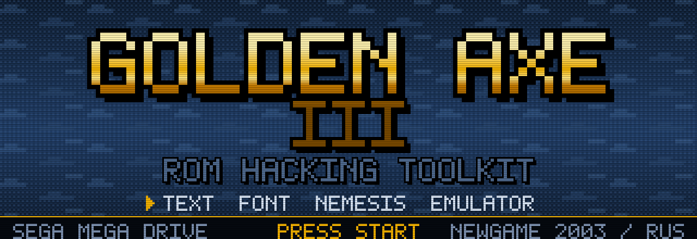
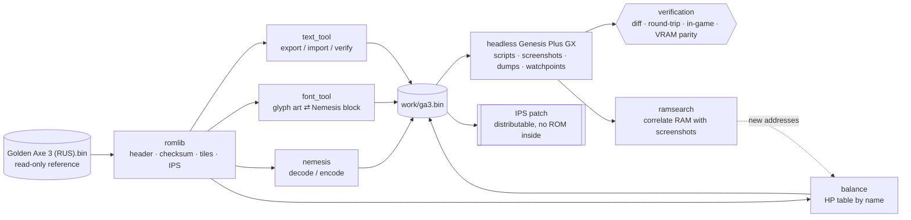

<div align="center">



**English** · [Русский](README.ru.md)

[](#)
[](#)
[](#)
[](#)
[](LICENSE)
[](#legal)
[](https://github.com/eugenez36/golden-axe3-game-rus/actions/workflows/ci.yml)

</div>

---

A ROM-hacking toolkit for **Golden Axe III** (Sega Mega Drive, 1993) built around the
**NEWGAME 2003 Russian translation**. It edits game text and the font, re-packs
Nemesis-compressed graphics at least as tightly as SEGA's own packer, tweaks gameplay
tables by name instead of by byte, and proves every change inside the real game using
a **headless Genesis Plus GX** frontend — no window, no SDL, just scripts, screenshots and memory dumps.

Nothing here is guessed. Every address, table and codec was pulled from the game's own
68000 code and confirmed by running it.

## Highlights

- **Byte-exact text round-trip.** 202 strings export → edit → import with zero diff.
  The character table was read from the game's tilemaps, not reverse-engineered by eye.
- **Nemesis codec, both ways.** Decoder lifted from the disassembly and verified against a
  VRAM dump (3072/3072 bytes). Encoder beats the original on all 14 blocks in the ROM:
  **13 808 bytes vs 14 033**, and always verifies itself by decoding what it wrote.
- **Font editing in plain text.** Glyphs as `#`/`.` art. New letters **Ё**, **Ъ** and
  parentheses added to a translation that never had them — confirmed by in-game screenshots.
- **Gameplay by name.** `balance.py set-hp 60 60 60 60` instead of poking `0x00E492`.
  Found with a RAM watchpoint, confirmed by the disassembly, verified with a HUD screenshot.
- **Headless emulator as a measuring instrument.** Scripted input, screenshots, VRAM/CRAM/RAM
  dumps, watchpoints, breakpoints and a `dma_hook` added to the core so DMA sources
  can be traced. A cheat-engine-style RAM correlator finds values from screenshots
  (player HP: r = 1.0000).

## How it fits together



## Quick start

> The ROM is not part of this repository. Put your own dump next to the tools as
> `Golden Axe 3 (RUS).bin` (1 MiB, header checksum `9BB5`) and work on a copy.

```bash
# environment
python3 -m venv tools/venv && tools/venv/bin/pip install -r requirements.txt
cp "Golden Axe 3 (RUS).bin" work/ga3.bin

# what is this image?
python3 tools/romlib.py info work/ga3.bin

# text: export → edit → verify → import
python3 tools/text_tool.py export work/ga3.bin -o text/strings.txt
python3 tools/text_tool.py verify work/ga3.bin text/strings.txt
python3 tools/text_tool.py import work/ga3.bin text/strings.txt

# font: glyphs as text art
python3 tools/font_tool.py export-art work/ga3.bin -o text/font.txt
python3 tools/font_tool.py import-art work/ga3.bin text/font.txt

# gameplay
python3 tools/balance.py show work/ga3.bin
python3 tools/balance.py set-hp work/ga3.bin 60 60 60 60

# see it in the actual game
make -C emu/headless
./emu/headless/headless_gpgx --rom work/ga3.bin --script scripts/menu.txt

# ship it without the ROM
python3 tools/romlib.py ips "Golden Axe 3 (RUS).bin" work/ga3.bin -o out/patch.ips
```

## ROM map

| Range | Contents |
|---|---|
| `000000–0000FF` | vector table (mostly `FFFFFFFF`; code squeezed in at `0x40`) |
| `000100–0001FF` | cartridge header |
| `000200–000283` | 33-entry pointer table — the main dispatcher |
| `000200–01C000` | 68000 code |
| `00E492` | **HP table**, 4 bytes: 51 · 59 · 67 · 75 |
| `0122FC` / `01230E` | `NemDec` / `NemDecToRAM` |
| `014E00–0151A0` | menu and options text |
| `01C000–02C000` | Nemesis-compressed graphics |
| `01D85E` | **font**: 96 tiles, Nemesis, no XOR, 839 bytes |
| `080000–0D8000` | uncompressed 4bpp tile art |
| `0E9B00–0EC300` | dialogue, credits, ending |
| `0FC000–0FFA1F` | PCM samples |
| `0FFA20` | entry point (moved by the translators from the original `0x200`) |

Free space: **914 bytes** in three holes. Anything longer than the original will need
`Rom.expand()` to 2 MiB.

## Roadmap

- [x] **v0.1 — Text & Font** · byte-exact round-trip, glyph editor, Ё / Ъ / ( ), translator credits
- [x] **v0.2 — Nemesis packer parity** · not worse than the original on all 14 blocks, self-verifying
- [x] **v0.3 — Headless emulator** · scripts, screenshots, dumps, watchpoints, `dma_hook`
- [ ] **v0.4 — Gameplay tables** · lives, magic, timers (method ready in `ramsearch.py`)
- [ ] **v1.0 — Release IPS** · verified patch set with RU + EN docs

Progress is tracked in [milestones](https://github.com/eugenez36/golden-axe3-game-rus/milestones).

## Repository layout

```
tools/          Python toolkit: romlib · table · text_tool · font_tool · nemesis · balance · ramsearch · disasm
emu/headless/   headless frontend for Genesis Plus GX (libc + zlib only)
emu/gpgx/       Genesis Plus GX core (submodule) + dma_hook patch
scripts/        emulator run scripts: wait · press · screenshot · dump · watch · bp …
text/           exported strings and font art
out/            IPS patches and screenshots (no ROM images)
docs/ru/        engineering journal — every finding, every dead end, in Russian
```

The full story of how each address was found lives in the
**[engineering journal](docs/ru/journal.md)** (Russian).

## Legal

- **No ROM is distributed here**, and none ever will be. Golden Axe III is © SEGA.
  "SEGA", "Mega Drive", "Genesis" and "Golden Axe" are trademarks of SEGA Corporation.
- The Russian translation this toolkit targets is the work of **NEWGAME (2003)**.
- The toolkit itself is [MIT](LICENSE). The emulator core, Genesis Plus GX, is by
  Charles MacDonald and Eke-Eke under its own **non-commercial** license — see
  [THIRD_PARTY_NOTICES.md](THIRD_PARTY_NOTICES.md).

<div align="center">
<sub>Built with a hex editor, a disassembler, and far too many screenshots of an orc.</sub>
</div>
