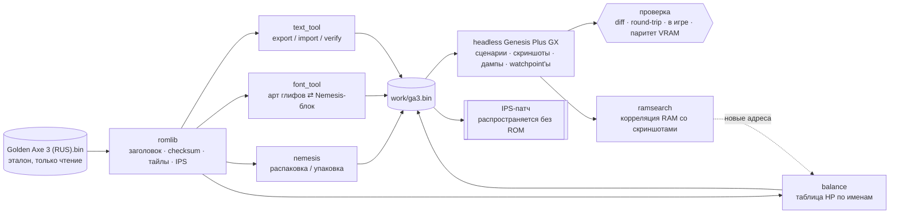

<div align="center">


[English](README.md) · **Русский**

[](#)
[](#)
[](#)
[](#)
[](LICENSE)
[](#правовое)
[](https://github.com/eugenez36/golden-axe3-game-rus/actions/workflows/ci.yml)

</div>

---

Тулкит для ромхакинга **Golden Axe III** (Sega Mega Drive, 1993) на базе **русификации
NEWGAME 2003**. Правит игровой текст и шрифт, перепаковывает Nemesis-графику не хуже
фирменного упаковщика SEGA, меняет геймплейные таблицы по именам, а не по байтам, и
доказывает каждую правку внутри настоящей игры через **headless-сборку Genesis Plus GX** —
без окна и SDL, только сценарии, скриншоты и дампы памяти.

Здесь ничего не угадано. Каждый адрес, таблица и кодек сняты с кода 68000 самой игры
и подтверждены её запуском.

## Что уже сделано

- **Текст туда и обратно байт в байт.** 202 строки: экспорт → правка → вставка без единого
  расхождения. Таблица символов снята с тайлмапов игры, а не подобрана на глаз.
- **Nemesis в обе стороны.** Распаковщик переписан с дизассемблера и проверен по дампу VRAM
  (3072 из 3072 байт). Упаковщик обгоняет оригинал на всех 14 блоках ROM:
  **13 808 байт против 14 033**, и всегда проверяет себя обратной распаковкой.
- **Шрифт правится как текст.** Глифы в виде `#`/`.`-арта. Дорисованы **Ё**, **Ъ** и круглые
  скобки, которых в русификации не было, — подтверждено скриншотами из игры.
- **Геймплей по именам.** `balance.py set-hp 60 60 60 60` вместо правки `0x00E492`.
  Найдено watchpoint'ом на RAM, подтверждено дизассемблером, проверено скриншотом HUD.
- **Эмулятор как измерительный прибор.** Сценарный ввод, скриншоты, дампы VRAM/CRAM/RAM,
  watchpoint'ы, брейкпоинты и добавленный в ядро `dma_hook`, без которого не найти источник
  графики. Поиск величин в RAM по скриншотам, как в читовом движке (HP игрока: r = 1.0000).

## Как всё связано



## Быстрый старт

> ROM в репозитории нет. Положи собственный дамп рядом с инструментами как
> `Golden Axe 3 (RUS).bin` (1 МиБ, checksum заголовка `9BB5`) и работай на копии.

```bash
# окружение
python3 -m venv tools/venv && tools/venv/bin/pip install -r requirements.txt
cp "Golden Axe 3 (RUS).bin" work/ga3.bin

# что за образ
python3 tools/romlib.py info work/ga3.bin

# текст: экспорт → правка → проверка → вставка
python3 tools/text_tool.py export work/ga3.bin -o text/strings.txt
python3 tools/text_tool.py verify work/ga3.bin text/strings.txt
python3 tools/text_tool.py import work/ga3.bin text/strings.txt

# шрифт как текстовый арт
python3 tools/font_tool.py export-art work/ga3.bin -o text/font.txt
python3 tools/font_tool.py import-art work/ga3.bin text/font.txt

# геймплей
python3 tools/balance.py show work/ga3.bin
python3 tools/balance.py set-hp work/ga3.bin 60 60 60 60

# посмотреть в самой игре
make -C emu/headless
./emu/headless/headless_gpgx --rom work/ga3.bin --script scripts/menu.txt

# отдать без ROM
python3 tools/romlib.py ips "Golden Axe 3 (RUS).bin" work/ga3.bin -o out/patch.ips
```

## Карта ROM

| Область | Содержимое |
|---|---|
| `000000–0000FF` | таблица векторов (почти вся `FFFFFFFF`; по `0x40` втиснут код) |
| `000100–0001FF` | заголовок картриджа |
| `000200–000283` | таблица из 33 указателей — главный диспетчер |
| `000200–01C000` | код 68000 |
| `00E492` | **таблица HP**, 4 байта: 51 · 59 · 67 · 75 |
| `0122FC` / `01230E` | `NemDec` / `NemDecToRAM` |
| `014E00–0151A0` | текст меню и опций |
| `01C000–02C000` | Nemesis-сжатая графика |
| `01D85E` | **шрифт**: 96 тайлов, Nemesis, без XOR, 839 байт |
| `080000–0D8000` | несжатый тайловый арт 4bpp |
| `0E9B00–0EC300` | диалоги, титры, финал |
| `0FC000–0FFA1F` | PCM-сэмплы |
| `0FFA20` | точка входа (сдвинута русификаторами с исходных `0x200`) |

Свободного места **914 байт** в трёх дырках. Всё, что длиннее оригинала, потребует
`Rom.expand()` до 2 МиБ.

## Дорожная карта

- [x] **v0.1 — Текст и шрифт** · round-trip байт в байт, редактор глифов, Ё / Ъ / ( ), титр переводчика
- [x] **v0.2 — Паритет упаковщика Nemesis** · не хуже оригинала на всех 14 блоках, самопроверка
- [x] **v0.3 — Headless-эмулятор** · сценарии, скриншоты, дампы, watchpoint'ы, `dma_hook`
- [ ] **v0.4 — Геймплейные таблицы** · жизни, магия, таймеры (метод готов в `ramsearch.py`)
- [ ] **v1.0 — Релизный IPS** · проверенный набор патчей с документацией RU + EN

Ход работы — в [milestones](https://github.com/eugenez36/golden-axe3-game-rus/milestones).

## Состав репозитория

```
tools/          Python-тулкит: romlib · table · text_tool · font_tool · nemesis · balance · ramsearch · disasm
emu/headless/   headless-фронтенд к Genesis Plus GX (только libc и zlib)
emu/gpgx/       ядро Genesis Plus GX (submodule) + патч dma_hook
scripts/        сценарии эмулятора: wait · press · screenshot · dump · watch · bp …
text/           выгруженные строки и арт шрифта
out/            IPS-патчи и скриншоты (образов ROM нет)
docs/ru/        инженерный журнал — каждая находка и каждый тупик
```

Как именно был найден каждый адрес — в **[инженерном журнале](docs/ru/journal.md)**.

## Правовое

- **ROM здесь не распространяется** и распространяться не будет. Golden Axe III — © SEGA.
  «SEGA», «Mega Drive», «Genesis» и «Golden Axe» — товарные знаки SEGA Corporation.
- Русификация, с которой работает тулкит, — труд группы **NEWGAME (2003)**.
- Сам тулкит — [MIT](LICENSE). Ядро эмулятора Genesis Plus GX — Charles MacDonald и Eke-Eke,
  под собственной **некоммерческой** лицензией — см. [THIRD_PARTY_NOTICES.md](THIRD_PARTY_NOTICES.md).

<div align="center">
<sub>Собрано hex-редактором, дизассемблером и неприличным количеством скриншотов орка.</sub>
</div>
