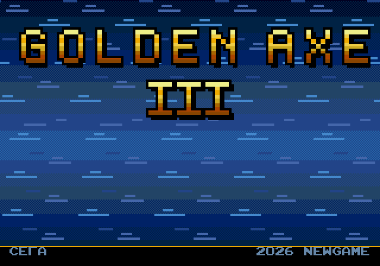
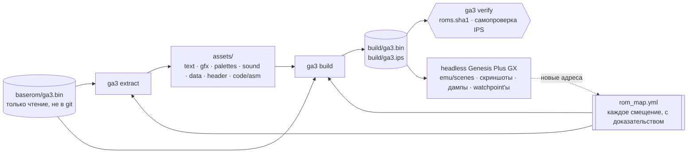

<div align="center">



[English](README.md) · **Русский**


[](LICENSE)
[](#правовое)
[](https://github.com/eugenez36/golden-axe3-game-rus/actions/workflows/ci.yml)

</div>

---

Тулкит для ромхакинга **Golden Axe III** (Sega Mega Drive, 1993) на базе
**русификации NEWGAME 2003**. Образ картриджа разобран на дерево редактируемых
ресурсов — текст, шрифт, Nemesis-графика, листы тайлов, палитры, сэмплы, таблицы,
листинги кода — и собирается из него обратно **байт в байт**. Каждая правка
доказывается в настоящей игре через **headless-сборку Genesis Plus GX**: без окна,
только сценарии, скриншоты и дампы памяти.

Здесь ничего не угадано. Каждое смещение живёт в одном файле, `rom_map.yml`,
вместе с доказательством, которое его туда привело.

```text
baserom/ga3.bin ──ga3 extract──▶ assets/ ──ga3 build──▶ build/ga3.bin + build/ga3.ips
   (ваш, никогда                 (в репозитории,           (сверяется
    не коммитится)                ROM «до винтика»)         с roms.sha1)
```

## Скачать и играть

Собирать ничего не нужно: в каждом выпуске на
[странице релизов](https://github.com/eugenez36/golden-axe3-game-rus/releases)
два файла.

- **`ga3-X.YY.ZZZ.bin`** — готовый образ этой версии для любого эмулятора Mega
  Drive (Genesis Plus GX, BlastEm, Kega Fusion, RetroArch) или флеш-картриджа:
  скачать, открыть, играть.
- **`ga3-X.YY.ZZZ.ips`** — те же изменения патчем, для тех, кто накладывает его
  на свой дамп русификации NEWGAME 2003 (его sha1 — первая строка `roms.sha1`).

Образ живёт только в релизах: в репозитории его нет (хук pre-commit не
пропускает ROM-файлы), а версия в главном меню говорит, какая сборка у вас.

## Что сделано

- **Воспроизводимая сборка.** `make` пересобирает образ из `assets/`, `make verify`
  сверяет его с `roms.sha1`. Свежеизвлечённые ресурсы дают эталонный ROM байт
  в байт, закоммиченные — сборку, записанную в `roms.sha1`.
- **ROM, разобранный до винтика.** Заголовок и векторы в YAML, 210 строк в одиннадцати
  текстовых файлах, шрифт как текстовый арт, 14 Nemesis-блоков, 22 индексированных
  PNG-листа тайлового арта, область PCM, таблица HP и геймплейные константы,
  данные панели героев, палитры этапов (28 в `.pal`), шесть снятых палитр и листинги
  Capstone для каждого сегмента кода. Что ещё не опознано — измерено, а не спрятано:
  `ga3 map` печатает покрытие.
- **Nemesis в обе стороны.** Распаковщик воспроизведён по дизассемблированному коду игры и проверен по
  дампу VRAM (3072 из 3072 байт). Упаковщик обгоняет фирменный на всех 14 блоках
  (13 780 против 14 045 байт); его вывод отличается от фирменного, поэтому ради
  байтовой идентичности сборка берёт исходные блоки как есть, пока вы их не
  отредактируете.
- **Шрифт правится как текст.** Глифы в виде `#`/`.`-арта. Дорисованы **Ё**, **ё**, **Ъ**,
  латинская **V**, круглые скобки и **/**, которых в русификации не было; сборка
  не принимает шрифт, не влезающий в свой слот из 840 байт (занято 837).
- **Геймплей по именам.** `ga3 balance show` перечисляет все таблицы и
  константы; `ga3 balance set-hp 60 60 60 60` правит таблицу HP, `set lives 5` /
  `set credits 9` / `set potions 3` / `set countdown 5` / `set prisoners 3` —
  запасные жизни, продолжения, значение по умолчанию для ОПЦИИ → БАНКИ МАГИИ
  (стартовые банки магии, 0–6), отсчёт экрана продолжения и цена жизни в
  пленниках, `set
  kain_super 20` / `set magic_l2 40` — силу удара и суперудара героя и урон
  заклинаний, `set walk_speed.kain_x 0x200` / `set move_speed.jump_sarah 0x700`
  — скорость ходьбы, рывка и прыжка каждого класса, `set stage_music.stage_1
  0x8E` — музыку этапа, `set boss_song_1 0x8E` — босса, `set ending_song 0x8E` —
  сцены ([docs/sound.md](docs/sound.md)). Панель героев на экране
  выбора читает те же файлы и не расходится с игрой. Это числа внутри кода и
  его таблиц, каждое сверяется с эталонным ROM; адреса — забота карты.
- **Новый код на ассемблере 68000.** Патчи лежат в `assets/patches/*.s`,
  собираются встроенным `ga3.m68k` (каждая форма инструкции проверена через
  Capstone) и встраиваются в игру только там, где в эталонном ROM стоят
  ожидаемые байты. Это счётчик убитых врагов рядом с HUD каждого игрока,
  характеристики героя на выборе персонажа, третья сложность «ЖЕСТЬ» и пункт
  ОПЦИИ → БАНКИ МАГИИ ([docs/patches.md](docs/patches.md)).
- **Эмулятор как измерительный прибор.** Сценарный ввод, скриншоты, дампы VDP и RAM,
  watchpoint'ы, брейкпоинты и добавленный в ядро `dma_hook`, без которого не найти
  источник графики. Поиск величин в RAM по скриншотам, как в читовом движке
  (HP игрока: r = 1.0000).

## Быстрый старт

> ROM в репозитории нет. Положите собственный дамп в `baserom/ga3.bin`
> (1 МиБ, SHA-1 `e9538c05…`, см. [baserom/README.md](baserom/README.md)).
> Полная установка: [INSTALL.md](INSTALL.md).

```bash
git clone --recurse-submodules https://github.com/eugenez36/golden-axe3-game-rus.git
cd golden-axe3-game-rus
make venv && source .venv/bin/activate

make            # build/ga3.bin + build/ga3.ips из assets/
make verify     # sha1sum -c roms.sha1
make test       # pytest (тесты, требующие ROM, без него пропускаются)

# что-нибудь поправить
$EDITOR assets/text/dialogue.txt          # строка; длиннее стать не может
$EDITOR assets/gfx/font/font.txt          # глиф
ga3 balance set-hp 60 60 60 60            # таблица HP
ga3 balance set stage_music.stage_1 0x8E # другая музыка на этапе 1 (docs/sound.md)
ga3 balance set walk_speed.kain_x 0x200   # параметр героя (список: ga3 balance show)
make && ga3 verify --update               # пересобрать, записать новый хеш
make dist                                 # файлы релиза: build/dist/ga3-ВЕРСИЯ.bin, .ips, .sha256

# посмотреть в самой игре
make emu && make regress                  # скриншоты в build/shots/
ga3 emu emu/scenes/dialogue_pages.txt

# осмотреться
ga3 map                                   # покрытие: что ещё неизвестно
ga3 map --check                           # карта против эталонного ROM
ga3 extract --only nem_013E76 --png      # превью Nemesis-блоков в build/preview/ (голый extract затрёт правки)
ga3 disasm E482 -n 12                     # код, читающий таблицу HP
```

## Как всё связано



## Состав репозитория

```text
rom_map.yml       единственный дом всех смещений ROM (сегменты в стиле splat)
roms.sha1         sha1 эталона и сборки; `make verify`
Makefile          venv · build · extract · verify · test · lint · assets · asm · emu · regress · clean · distclean · help
pyproject.toml    пакет ga3 и его команда `ga3`
baserom/          сюда кладётся ваш ROM (игнорируется)
assets/           ROM, разобранный на части — что коммитится, см. STYLE.md
  header/         vectors.yml, header.yml
  text/           menu · stages · ending · dialogue · misc · menu_items · difficulty · options · code_main_{b,d,e} .txt, encoding.tbl
  gfx/            font/font.txt, nemesis/*.nem, tiles/art_*.png (индексированные)
  palettes/       *.pal: палитры этапов из ROM (pal_lines, pal_pool) и шесть снятых в эмуляторе
  sound/pcm/      samples.pcm
  data/           hp_table.yml, walk_speed.yml, move_speed.yml, stage_music.yml, gameplay.yml (жизни, кредиты, банки, сила ударов,
                  урон магии, музыка боссов и сцен), hero_panel.yml (имена и темп; числа берутся из остальных файлов)
  patches/        *.s: исходники собираемых патчей на 68000 (kill_counter, hero_panel, difficulty, options, menus)
  code/asm/       листинги Capstone (генерируются)
build/            всё производное (игнорируется): ROM, IPS, эмулятор, скриншоты, дампы, превью
src/ga3/          тулкит: rom · nemesis · enigma · table · text · font · tiles · palette · screen · banner_art · rom_map · assets/ · pipeline · patches · m68k · constants · hero_panel · balance · disasm · ramsearch · lag · cli
tests/            pytest; фикстуры без ROM плюс тесты, требующие ROM
emu/              gpgx (submodule) · patches/ · headless/ · scenes/ · explore/
docs/             README (оглавление) · build · text_format · nemesis · font · emulator · patches · heroes · rom_map (генерируется) · evidence/ · images/ · branding/ · ru/journal.md · ru/proofreading.md
```

## Карта ROM

Генерируется из `rom_map.yml`: [docs/rom_map.md](docs/rom_map.md). Коротко:

| Область                          | Содержимое                                                                                                                                                               |
|----------------------------------|--------------------------------------------------------------------------------------------------------------------------------------------------------------------------|
| `000000–000200`                  | векторы и заголовок (точка входа перенесена русификаторами на `0FFA20`)                                                                                                  |
| `000200–01B780`                  | код 68000; внутри таблица HP `00E492`, Nemesis-блок `013E76`, текст меню / уровней / концовки, процедура версии, пункты главного меню и счётчик убитых в `0116B6–011800` |
| `01B780–01E3DC`                  | 12 Nemesis-блоков почти впритык (6 байт данных после шрифта, 43 неизвестных байта в `01E26F`), шрифт в `01D85E` (840 Б)                                                  |
| `0295EE–029F08`                  | ещё один Nemesis-блок (208 тайлов)                                                                                                                                       |
| `031E16–032934`                  | палитры этапов: базовые наборы, линия 3 по этапу, 69 скриптов палитр, 8 циклов цветов; 28 целых палитр в `.pal` (`pal_lines`, `pal_pool`)                                |
| `05AEAA–05AFCE`, `05B30A–05B42A` | код отображения счётчика убитых и глифы цифр, в двух бывших дырах                                                                                                        |
| `080000–0D8000`                  | 11 264 несжатых тайла 4bpp                                                                                                                                               |
| `0E9B00–0EC300`                  | диалоги, титры, концовка                                                                                                                                                 |
| `0F0000–0FFA10`                  | звук: драйвер SMPS 68k, 27 песен, эффекты, DAC-драйвер Z80 в `0FACC8` и его сэмплы с `0FAEB8`                                                                            |
| `0FFA20–100000`                  | перенесённый входной стаб                                                                                                                                                |
| `100000–102280`                  | панель характеристик героев и сложность «ЖЕСТЬ» (патчи `hero_panel`, `difficulty`)                                                                                       |
| `102280–102400`                  | свободно: старые слоты патча `options`                                                                                                                                   |
| `102400–102700`                  | «ЖЕСТЬ»: где появляется копия из очереди (патч `difficulty`)                                                                                                             |
| `102700–102760`                  | «ЖЕСТЬ»: второе зелье от удара по гному (патч `difficulty`)                                                                                                              |
| `102760–104920`                  | меню в стиле баннера: код, текст нижней полосы, тайлы, карты и палитры (патч `menus`)                                                                                    |
| `104920–104C00`                  | пункты БАНКИ МАГИИ и 100 ВРАГОВ, засчитанное убийство и жизнь за каждые 100 (патчи `options`, `kill_counter`)                                                            |
| `104C00–200000`                  | свободно: сборка расширена до 2 МБ (`rom.build_size`)                                                                                                                    |

Свободного места **около 1 МБ** (1 029 120 байт) в `104C00–1FFFFF` и ещё 384 в `102280–1023FF`: сборка расширена до 2 МБ
(`rom.build_size` в `rom_map.yml`; эталонный дамп остаётся 1 МБ). В самом
исходном образе из 914 байт в трёх проверенных дырах осталось 28 — остальное
заняли патчи (версия в меню, пункты меню, счётчик убитых). Около половины образа
пока `unknown`; точную цифру и диапазоны печатает `ga3 map`.

## Дорожная карта

- [x] **v0.10 — Текст и шрифт** · round-trip байт в байт, редактор глифов, Ё / Ъ / ( ), титр переводчика
- [x] **v0.20 — Паритет упаковщика Nemesis** · меньше оригинала на всех 14 блоках, самопроверка
- [x] **v0.30 — Headless-эмулятор** · сцены, скриншоты, дампы, watchpoint'ы, `dma_hook`
- [x] **v0.35 — Воспроизводимая сборка** · `rom_map.yml`, `assets/`, `build/`, `roms.sha1`, тесты, CI
- [x] **v0.37.400 — Текст и счётчик убитых** · вычитка текста, счётчик до 999, поиск ошибок ([CHANGELOG](CHANGELOG.md))
- [x] **v0.37.500 — Характеристики героев, ЖЕСТЬ и БАНКИ МАГИИ** · панель героев на выборе персонажа, третья сложность, стартовые банки магии в ОПЦИЯХ, сборка 2 МБ ([CHANGELOG](CHANGELOG.md))
- [x] **v0.37.600 — Исправления «ЖЕСТЬ» и счётчика** · копии выходят из-за края экрана на землю, гном роняет две банки, цифры счётчика в VRAM `DF00` ([CHANGELOG](CHANGELOG.md))
- [x] **v0.37.700 — Меню в стиле баннера, 100 ВРАГОВ** · титул, меню и выбор героя в стиле баннера, жизнь за каждые сто убийств (OPTIONS → 100 ВРАГОВ), сборка вдвое быстрее ([CHANGELOG](CHANGELOG.md))
- [x] **v0.37.800 — Геймплей по именам** · скорости и удары героев, урон магии, отсчёт продолжения и цена жизни в пленниках через `ga3 balance`, панель героев читает те же файлы; сборка вдвое быстрее, `softreset` в эмуляторе ([CHANGELOG](CHANGELOG.md))
