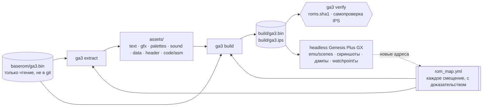

<div align="center">


[English](README.md) · **Русский**


[](LICENSE)
[](#правовое)
[](https://github.com/eugenez36/golden-axe3-game-rus/actions/workflows/ci.yml)

</div>

---

Тулкит для ромхакинга **Golden Axe III** (Sega Mega Drive, 1993) на базе
**русификации NEWGAME 2003**. Образ картриджа разобран на дерево редактируемых
ресурсов — текст, шрифт, Nemesis-графика, листы тайлов, палитры, сэмплы, таблицы,
листинги кода — и собирается из него обратно **байт в байт**. Каждая правка
доказывается в настоящей игре через **headless-сборку Genesis Plus GX**: без окна,
только сценарии, скриншоты и дампы памяти.

Здесь ничего не угадано. Каждое смещение живёт в одном файле, `rom_map.yml`,
вместе с доказательством, которое его туда привело.

```text
baserom/ga3.bin ──ga3 extract──▶ assets/ ──ga3 build──▶ build/ga3.bin + build/ga3.ips
   (ваш, никогда                 (в репозитории,           (сверяется
    не коммитится)                ROM «до винтика»)         с roms.sha1)
```

## Что сделано

- **Воспроизводимая сборка.** `make` пересобирает образ из `assets/`, `make verify`
  сверяет его с `roms.sha1`. Свежеизвлечённые ресурсы дают эталонный ROM байт
  в байт, закоммиченные — сборку, записанную в `roms.sha1`.
- **ROM, разобранный до винтика.** Заголовок и векторы в YAML, 227 строк в девяти
  текстовых файлах, шрифт как текстовый арт, 14 Nemesis-блоков, 22 индексированных
  PNG-листа тайлового арта, область PCM, таблица HP, шесть снятых палитр и листинги
  Capstone для каждого сегмента кода. Что ещё не опознано — измерено, а не спрятано:
  `ga3 map` печатает покрытие.
- **Nemesis в обе стороны.** Распаковщик воспроизведён по дизассемблированному коду игры и проверен по
  дампу VRAM (3072 из 3072 байт). Упаковщик обгоняет фирменный на всех 14 блоках
  (13 780 против 14 045 байт), поэтому его вывод отличается от фирменного, и ради
  байтовой идентичности сборка берёт исходные блоки как есть, пока вы их не
  отредактируете.
- **Шрифт правится как текст.** Глифы в виде `#`/`.`-арта. Дорисованы **Ё**, **ё**, **Ъ**,
  латинская **V** и круглые скобки, которых в русификации не было; сборка не
  принимает шрифт, не влезающий в свой слот из 840 байт.
- **Геймплей по именам.** `ga3 balance set-hp 60 60 60 60` правит YAML-таблицу;
  адрес — забота карты.
- **Новый код на ассемблере 68000.** Патчи лежат в `assets/patches/*.s`,
  собираются встроенным `ga3.m68k` (каждая форма инструкции проверена через
  Capstone) и встраиваются в игру только там, где в эталонном ROM стоят
  ожидаемые байты. Первый — счётчик убитых врагов рядом с HUD каждого игрока
  ([docs/patches.md](docs/patches.md)).
- **Эмулятор как измерительный прибор.** Сценарный ввод, скриншоты, дампы VDP и RAM,
  watchpoint'ы, брейкпоинты и добавленный в ядро `dma_hook`, без которого не найти
  источник графики. Поиск величин в RAM по скриншотам, как в читовом движке
  (HP игрока: r = 1.0000).

## Быстрый старт

> ROM в репозитории нет. Положите собственный дамп в `baserom/ga3.bin`
> (1 МиБ, SHA-1 `e9538c05…`, см. [baserom/README.md](baserom/README.md)).
> Полная установка: [INSTALL.md](INSTALL.md).

```bash
git clone --recurse-submodules https://github.com/eugenez36/golden-axe3-game-rus.git
cd golden-axe3-game-rus
make venv && source .venv/bin/activate

make            # build/ga3.bin + build/ga3.ips из assets/
make verify     # sha1sum -c roms.sha1
make test       # pytest (тесты, требующие ROM, без него пропускаются)

# что-нибудь поправить
$EDITOR assets/text/dialogue.txt          # строка; длиннее стать не может
$EDITOR assets/gfx/font/font.txt          # глиф
ga3 balance set-hp 60 60 60 60            # таблица HP
make && ga3 verify --update               # пересобрать, записать новый хеш

# посмотреть в самой игре
make emu && make regress                  # скриншоты в build/shots/
ga3 emu emu/scenes/dialogue_pages.txt

# осмотреться
ga3 map                                   # покрытие: что ещё неизвестно
ga3 map --check                           # карта против эталонного ROM
ga3 extract --png                         # превью Nemesis-блоков в build/preview/
ga3 disasm E482 -n 12                     # код, читающий таблицу HP
```

## Как всё связано



## Состав репозитория

```text
rom_map.yml       единственный дом всех смещений ROM (сегменты в стиле splat)
roms.sha1         sha1 эталона и сборки; `make verify`
Makefile          venv · build · extract · verify · test · lint · assets · asm · emu · regress · clean · distclean · help
pyproject.toml    пакет ga3 и его команда `ga3`
baserom/          сюда кладётся ваш ROM (игнорируется)
assets/           ROM, разобранный на части — что коммитится, см. STYLE.md
  header/         vectors.yml, header.yml
  text/           menu · stages · ending · dialogue · misc · menu_items · code_main_{b,d,e} .txt, encoding.tbl
  gfx/            font/font.txt, nemesis/*.nem, tiles/art_*.png (индексированные)
  palettes/       *.pal, снятые в эмуляторе (источник в ROM пока не найден)
  sound/pcm/      samples.pcm
  data/           hp_table.yml
  code/asm/       листинги Capstone (генерируются)
build/            всё производное (игнорируется): ROM, IPS, эмулятор, скриншоты, дампы, превью
src/ga3/          тулкит: rom · nemesis · table · text · font · tiles · palette · rom_map · assets/ · pipeline · patches · m68k · balance · disasm · ramsearch · lag · cli
tests/            pytest; фикстуры без ROM плюс тесты, требующие ROM
emu/              gpgx (submodule) · patches/ · headless/ · scenes/ · explore/
docs/             README (оглавление) · build · text_format · nemesis · font · emulator · patches · rom_map (генерируется) · evidence/ · images/ · branding/ · ru/journal.md · ru/proofreading.md
```

## Карта ROM

Генерируется из `rom_map.yml`: [docs/rom_map.md](docs/rom_map.md). Коротко:

| Область                          | Содержимое                                                                                                                                                               |
|----------------------------------|--------------------------------------------------------------------------------------------------------------------------------------------------------------------------|
| `000000–000200`                  | векторы и заголовок (точка входа перенесена русификаторами на `0FFA20`)                                                                                                  |
| `000200–01B780`                  | код 68000; внутри таблица HP `00E492`, Nemesis-блок `013E76`, текст меню / уровней / концовки, процедура версии, пункты главного меню и счётчик убитых в `0116B6–011800` |
| `01B780–01E3DC`                  | 12 Nemesis-блоков почти впритык (6 байт данных после шрифта, 43 неизвестных байта в `01E26F`), шрифт в `01D85E` (840 Б)                                                  |
| `0295EE–029F08`                  | ещё один Nemesis-блок (208 тайлов)                                                                                                                                       |
| `05AEAA–05AFC6`, `05B30A–05B41A` | код отображения счётчика убитых и глифы цифр, в двух бывших дырах                                                                                                        |
| `080000–0D8000`                  | 11 264 несжатых тайла 4bpp                                                                                                                                               |
| `0E9B00–0EC300`                  | диалоги, титры, концовка                                                                                                                                                 |
| `0FC000–0FFA20`                  | PCM-сэмплы                                                                                                                                                               |
| `0FFA20–100000`                  | перенесённый входной стаб                                                                                                                                                |

Свободного места осталось **28 байт** из 914 в трёх проверенных дырах; остальное
заняли патчи (версия в меню, пункты меню, счётчик убитых). Около половины образа
пока `unknown`; точную цифру и диапазоны печатает `ga3 map`.

## Дорожная карта

- [x] **v0.1 — Текст и шрифт** · round-trip байт в байт, редактор глифов, Ё / Ъ / ( ), титр переводчика
- [x] **v0.2 — Паритет упаковщика Nemesis** · меньше оригинала на всех 14 блоках, самопроверка
- [x] **v0.3 — Headless-эмулятор** · сцены, скриншоты, дампы, watchpoint'ы, `dma_hook`
- [x] **v0.35 — Воспроизводимая сборка** · `rom_map.yml`, `assets/`, `build/`, `roms.sha1`, тесты, CI
- [ ] **v0.4 — Геймплейные таблицы** · жизни, магия, таймеры (метод готов в `ga3 ramsearch`); счётчик убитых готов
- [ ] **v0.5 — Палитры и тайлмапы в ROM** · превратить серые листы тайлов в настоящие цвета
- [ ] **v1.0 — Релизный IPS** · проверенный патч с документацией RU + EN

Ход работы — в [milestones](https://github.com/eugenez36/golden-axe3-game-rus/milestones).

## Как играть

Наложите `build/ga3.ips` на свой дамп или запустите `build/ga3.bin` в любом
эмуляторе Mega Drive. В Genesis Plus GX (RetroArch) опция *System Overclock*
150–200% сокращает паузы при загрузке магии, а *Remove Per-Line Sprite Limit*
убирает мерцание спрайтов; замеры — в [docs/emulator.md](docs/emulator.md#lag-and-overclock).
Синяя плашка справа от HUD каждого игрока считает убитых им врагов (до 999);
счёт обнуляется при выборе режима в главном меню, в дуэли плашки нет.

## Документы

[INSTALL.md](INSTALL.md) · [CHANGELOG.md](CHANGELOG.md) · [STYLE.md](STYLE.md) ·
[CONTRIBUTING.md](CONTRIBUTING.md) ·
[docs/build.md](docs/build.md) · [docs/text_format.md](docs/text_format.md) ·
[docs/nemesis.md](docs/nemesis.md) · [docs/font.md](docs/font.md) ·
[docs/emulator.md](docs/emulator.md) · [docs/patches.md](docs/patches.md) ·
[docs/evidence](docs/evidence/README.md) ·
**[инженерный журнал](docs/ru/journal.md)** — как был найден каждый адрес, включая тупики.

## Правовое

- **ROM здесь не распространяется** и распространяться не будет. Golden Axe III — © SEGA.
  «SEGA», «Mega Drive», «Genesis» и «Golden Axe» — товарные знаки SEGA Corporation.
- В `assets/` лежат данные, извлечённые из игры в редактируемом виде, чтобы правки
  читались как diff. Вместе с эталонным ROM они восстанавливают образ; репозиторий сам
  по себе — нет: код и неопознанные области намеренно не коммитятся (см. [STYLE.md](STYLE.md)).
- Русификация, с которой работает тулкит, — труд группы **NEWGAME (2003)**.
- Тулкит — [MIT](LICENSE). Genesis Plus GX — Charles MacDonald и Eke-Eke, под собственной
  **некоммерческой** лицензией; см. [THIRD_PARTY_NOTICES.md](THIRD_PARTY_NOTICES.md).

<div align="center">
<sub>Собрано hex-редактором, дизассемблером и неприличным количеством скриншотов орка.</sub>
</div>
