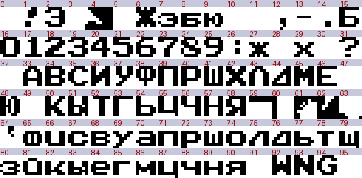

# Font

*Russian original: `ru/journal.md`, «Правка шрифта».*

One Nemesis block, `01D85E`, 96 tiles, serves every screen: the menu reuses
the same array with a swapped background index (only five decorative tiles
differ). Glyphs use **background colour 12 and ink colour 6** with no transparent
pixels — the reason a search for "two-colour tiles" never found the font.
The block's slot is exactly 840 bytes; `ga3 font info` prints the margin after
recompression from the current art.



## Editing

The source of truth is `assets/gfx/font/font.txt`:

```
@ 4F  'Ъ'
####....
..##....
..##....
..####..
..##.##.
..##.##.
..####..
........
```

A header per glyph (byte, current character), then 8 rows of 8 marks: `#` ink,
`.` background, a hex digit for any other palette index. Comments start with
`;` — a `#` at the start of a line is a pixel. Do not edit the header lines.

Workflow: edit the art → `ga3 build` (recompresses, refuses if the block would
not fit) → `ga3 assets refresh` (updates the committed `font.nem`) →
`make regress` and look at `build/shots/dialogue_p*.png`.

## Slots

| State | Blank slots |
|---|---|
| original translation | `2A 2B 3C 3E 40 4F 51 7B 7F` (nine) |
| this project | `3C 3E 40 7B 7F` (five) — `2A` `(`, `2B` `)`, `4F` Ъ, `51` Ё were drawn |

Six slots (`23`, `5B`–`5F`) are drawn — box rules, a bar, wedges — but have no
character; `font.txt` marks them `not in table`, and they are not counted as free.

A new letter needs three edits in one commit: the glyph in `font.txt`, the
character in `src/ga3/table.py`, and `ga3 assets refresh` for `encoding.tbl`
and `font.nem`.

## Verification

- Ё: seen in-game, `docs/images/newletters.png`.
- `(` `)`: seen in-game, `docs/images/parens.png`.
- Ъ: verified in the font data only. It appears in the second NPC's line
  («Не волнуйся, я разЪярЁн!»), which needs playing into stage 1;
  `emu/scenes/dialogue_pages.txt` is the scene to extend for that.

Repacking unchanged glyphs must reproduce the VRAM dump byte for byte
(`tests/fixtures/font_vram.4bpp`); that test catches packer regressions better
than any visual check.
